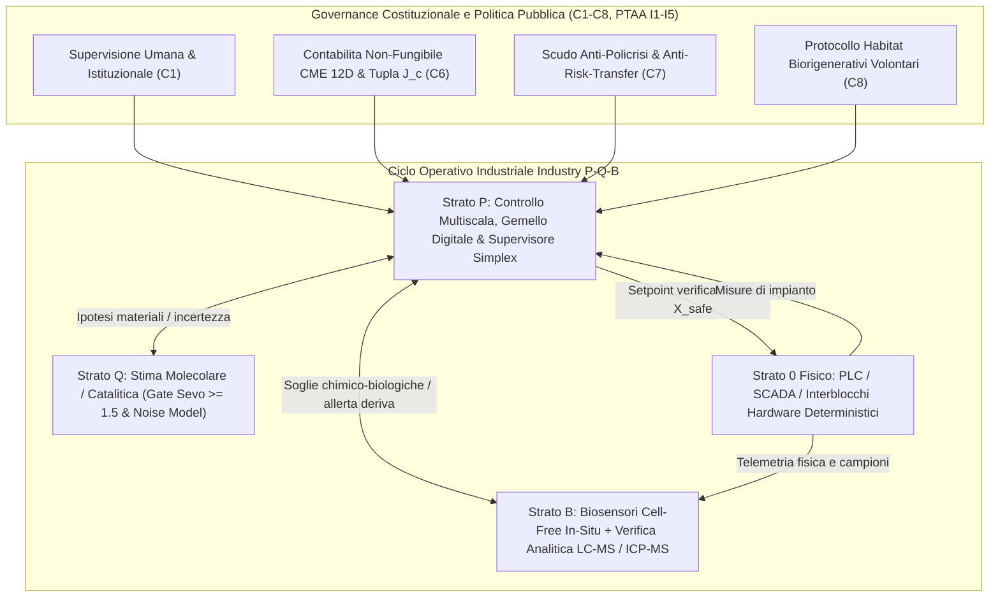
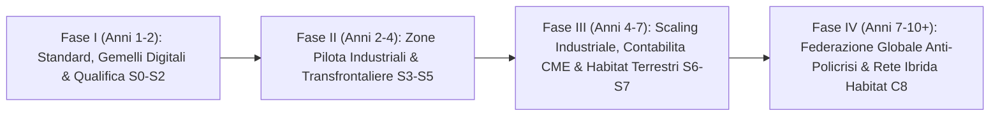

# T007 — Blueprint Scientifico, Ingegneristico, Economico e Istituzionale per l'Implementazione Globale di Industry P–Q–B

**Stato del documento:** Specifica di Architettura Sistemica, Ingegneria Industriale e Governance Economica (`v1.0`)  
**Data:** 2026-11-27  
**Riferimenti normativi e codice validato:**
- Paradigma base e benchmark: [T002_INDUSTRY_PQB_FRAMEWORK.md](T002_INDUSTRY_PQB_FRAMEWORK.md), [T006_INDUSTRY_PQB_TRIADIC_SAFEGUARD_SPEC.md](T006_INDUSTRY_PQB_TRIADIC_SAFEGUARD_SPEC.md), `b_speace/pqb_safeguard/evaluator.py`
- Salvaguardia triadica e qualificazione: `q_speace/docs/T254_TRIADIC_SAFEGUARD_AND_POLYCRISIS_RESILIENCE_SPEC.md`, `q_speace/docs/T217_SAFE_ASSIMILATION_LIFECYCLE_SPEC.md`, `q_speace/docs/T208_DEVELOPMENT_GUIDELINES_SPEC.md`
- Primitivi economici e conformità normativa: `q_speace/q_speace/economy/primitives.py`, `q_speace/q_speace/ptaa/scc.py`, `q_speace/docs/T240_REGULATORY_COMPLIANCE_AND_ANNEX_IV_GUIDE_EN.md`

---

## 1. Scopo, Rigore Epistemico e Confini Invarianti (`BCEL` & `T208`)

Il presente documento fornisce un protocollo scientifico, ingegneristico, macroeconomico e giuridico-istituzionale per adottare il paradigma **Industry P–Q–B** — arricchito dai criteri di salvaguardia triadica (`C6`), resilienza anti-policrisi (`C7`) e strutture abitative biorigenerative volontarie (`C8`) — all'interno:
1. delle **filiere industriali e infrastrutturali** esistenti (manifattura, acqua, energia, chimica, agroalimentare, sanità, edilizia, telecomunicazioni);
2. dei **sistemi economici, fiscali e finanziari** (contabilità nazionale multi-capitale, appalti pubblici, politica industriale e allocazione del credito);
3. della **governance politica delle nazioni e dei trattati transfrontalieri** (interoperabilità verificabile, sicurezza fisica e tutela dei diritti fondamentali).

> [!IMPORTANT]
> **Confini scientifici e non-pretese obbligatorie (`BCEL` / `T208` §3 & §9):**  
> Nessun componente di `Industry P–Q–B`, `b_speace` o `q_speace` rivendica coscienza artificiale, senzienza biologica negli organoidi/biosensori, comunicazione superluminale tramite entanglement quantistico o vantaggio quantistico universale. Ogni strato (`P`, `Q`, `B`) è trattato esclusivamente come una risorsa computazionale, metrologica o di controllo soggetta a taratura fisica, incertezza dichiarata, ablazione empirica contro baseline classiche e supervisione umana deterministica.

### Classificazione di maturità delle componenti nel documento

| Categoria | Stato attuale verificabile | Regola di adozione |
|---|---|---|
| **Primitivi software implementati e testati** | Vettore `CME` 12D, tupla fisica `J_c`, token `DAT`, controllori `PQBTriadicSafeguardController` (`T006`) e `TriadicPolycrisisGuard` (`T254`), continuità `T005`, gemello filtro acqua `T003`, profili `PTAA SCC` e pacchetti `EU AI Act Annex IV` (`T240`) | Pronti per integrazione *advisory* e simulazione su gemelli digitali aziendali e istituzionali |
| **Tecnologie hardware `P–Q–B` esistenti sul mercato** | Controllori industriali PLC/SCADA (`IEC 61508`), biosensori cell-free allosterici in-situ (es. piattaforme tipo ROSALIND validate con `LC-MS`/`ICP-MS`), simulatori quantistici rumorosi e QPU NISQ | Adottabili selettivamente solo dove l'ablazione a 4 vie (`P`, `P+B`, `P+Q`, `P+Q+B`) dimostra un beneficio netto misurato |
| **Riforme economiche, normative e infrastrutturali (`C8`)** | Proposte architetturali e istituzionali ingegnerizzate | Subordinate a iter legislativo democratico e all'intero ciclo di qualificazione `S0–S7` di `T217` |

---

## 2. Diagnosi Sistemica: Perché Industria 4.0/5.0 e Contabilità Scalare Falliscono sotto Policrisi

I paradigmi industriali ed economici contemporanei presentano tre limiti strutturali misurabili:

1. **Compressione informativa distruttiva del segnale di prezzo scalare:** ridurre decisioni industriali e macroeconomiche a un unico scalare monetario proietta uno spazio di stato fisico multi-dimensionale (exergia in joule, entropia esportata in $\text{J/K}$, rigenerazione ecologica, salute pubblica, resilienza di rete) su una sola coordinata fungibile. Ciò consente la **compensazione fittizia**: un'impresa o una nazione può registrare un aumento di valore aggiunto monetario mentre degrada irreversibilmente falde acquifere, suolo, coesione sociale o ridondanza infrastrutturale.
2. **Cecità alle cascate da policrisi:** le crisi attuali (climatica-ecologica, economica, sociale, sanitaria, cyber-infrastrutturale) non sono eventi indipendenti ma un sistema dinamico accoppiato. Ottimizzare localmente un singolo settore (es. ridurre i costi logistici eliminando scorte sanitarie ed energetiche, o decelerare emissioni tramite shock regressivi sul benessere sociale) trasferisce e amplifica l'instabilità sugli altri domini.
3. **Separazione tra calcolo digitale, chimica molecolare e metrologia biologica:** nell'Industria 4.0 il software (`P`) ottimizza processi macroscopici con ritardi elevati rispetto alla realtà molecolare e biologica: le analisi di laboratorio (`LC-MS`, `ICP-MS`) richiedono giorni e alti costi marginali, mentre la progettazione di nuovi materiali filtranti o catalitici esplora alla cieca spazi chimici combinatori.

---

## 3. Fondamenti Scientifici e Architettura a Ciclo Chiuso di `Industry P–Q–B`

**Industry P–Q–B** unifica tre regimi fisici di elaborazione dell'informazione sotto una governance dell'incertezza **fail-closed** basata sull'architettura Simplex:

- **Strato `P` (Procedural / Calcolo Classico Deterministico e Multiscala):** esegue modelli fisici conservativi (bilanci di massa, energia, trasporto), pianificazione della produzione, verifica su tubi di raggiungibilità (`SafetyContract`), failover con epoch fencing (`T005`) e applicazione deterministica dei vincoli costituzionali `C1–C8`. **Detiene l'autorità esclusiva di blocco e fallback.**
- **Strato `Q` (Quantum / Sottoproblemi Molecolari e Combinatori Selettivi):** interviene esclusivamente su sottoproblemi ben condizionati (energia di legame sito-contaminante, catalisi per fissazione dell'azoto o cattura di $\text{CO}_2$, materiali per batterie/membrane), vincolato dal cancello di efficienza entropica:
  $$\mathrm{Sevo} = \frac{\Delta U}{\Delta S_{\mathrm{info}}} \ge 1.5$$
  e dal confronto obbligatorio con il miglior solutore classico disponibile a pari budget energetico e computazionale (`H4 dequantization gate`: se il modello classico è sufficiente, `Q` viene disattivato).
- **Strato `B` (Biological / Biosensoristica Cell-Free e Trasduzione Bio-Ispirata):** utilizza circuiti biomolecolari acellulari calibrati (trasduzione allosterica di Hill a bassissima energia per screening rapido in-situ di acqua, aria, suolo e patogeni) ed eventuali banchi bio-elettrici confinati da `WetwareSafetyEnvelope`, **sempre accoppiati a verifiche periodiche su strumentazione analitica di riferimento** per confinare deriva e falsi positivi/negativi.

### Formalizzazione Matematica dei Tre Nuovi Criteri (`T254` / `T006`)

#### A. Salvaguardia Triadica Non-Compensabile (`C6`)
Lo stato patrimoniale di un impianto industriale, di una filiera o di una nazione è rappresentato dal vettore a 12 capitali non fungibili $c \in [0, 1]^{12}$ (`CME`), ripartito biunivocamente nei tre substrati costitutivi:
- **Pianeta Terra ($\mathcal{I}_{\mathrm{Earth}}$):** `ecology`, `regeneration`, `matter`, `coherence`
- **Civiltà Umana ($\mathcal{I}_{\mathrm{Civ}}$):** `wellbeing`, `distribution`, `time`, `innovation`
- **Tecnologie e Infrastrutture ($\mathcal{I}_{\mathrm{Infra}}$):** `energy`, `information`, `resilience`, `reversibility`

Una trasformazione industriale o politica $c^{\mathrm{pre}} \to c^{\mathrm{post}}$ è ammissibile **solo se**, per tutti e tre i pilastri $P \in \{\mathrm{Earth}, \mathrm{Civ}, \mathrm{Infra}\}$:
$$\min_{i \in \mathcal{I}_P} c^{\mathrm{post}}_i \ge \tau^{\mathrm{axis}}_P, \qquad \frac{1}{4}\sum_{i \in \mathcal{I}_P} c^{\mathrm{post}}_i \ge \tau^{\mathrm{mean}}_P, \qquad \min_{i \in \mathcal{I}_P}\left(c^{\mathrm{post}}_i - c^{\mathrm{pre}}_i\right) \ge -\delta^{\max}_{\mathrm{sacrifice}}.$$

#### B. Dinamica Accoppiata delle Policrisi e Anti-Trasferimento del Rischio (`C7`)
Sia $s^{(0)} \in [0, 1]^5$ il vettore di severità delle cinque crisi interconnesse ($\text{climatic\_ecological}$, $\text{economic}$, $\text{social}$, $\text{sanitary}$, $\text{cyber\_infrastructural}$), $W \in \mathbb{R}_{\ge 0}^{5 \times 5}$ ($W_{dd}=0$) la matrice empirica di amplificazione inter-crisi e $\gamma \in (0, 1)^5$ il tasso di assorbimento/smorzamento istituzionale. Ogni piano industriale o macroeconomico con forzante stimata $u \in [-1, 1]^5$ viene propagato su orizzonte $H$:
$$s^{(t+1)}(u) = \mathrm{clip}\!\Big((1 - \gamma) \odot s^{(t)}(u) + W s^{(t)}(u) + u, \; 0, \; 1\Big).$$
L'intervento viene **bloccato** se trasferisce rischio collaterale su un altro dominio ($\max_{1 \le t \le H}[s^{(t)}_q(u) - s^{(t)}_q(0)] > \delta_{\mathrm{collateral}}$) o se amplifica l'indice quadratico di sinergia sistemica $\Pi(s) = (s^\top W s)/\sum_{d \ne q} W_{dq}$.

#### C. Protocollo per Habitat Biorigenerativi Volontari (`C8`)
La filiera delle costruzioni, dell'energia, dell'acqua e delle biotecnologie `Industry P–Q–B` concorre a realizzare moduli abitativi ad alta resilienza (`terrestrial`, `hybrid_federated` ed eventualmente `extraterrestrial`), governati da tre regole inderogabili:
1. **Autonomia individuale:** ingresso e uscita esclusivamente su scelta libera della persona (`voluntary_opt_in_only`, `free_exit_guaranteed`), con pari dignità tra necessità di protezione da policrisi e ricerca del proprio benessere personale.
2. **Capacità vitale e psicosociale di Leontief `N+2` ($\kappa \ge 1.25$):**
   $$N_{\mathrm{cert}} = \left\lfloor \min_{r \in \{\text{acqua}, \text{cibo}, \text{ossigeno}, \text{energia}\}} \frac{\mathrm{Supply}_r}{\kappa \cdot \mathrm{MinPerCapita}_r} \right\rfloor,$$
   integrata da soglie obbligatorie per assistenza medico-sanitaria ($I_{\mathrm{med}} \ge 0.75$), qualità dello spazio psicosociale ($I_{\mathrm{well}} \ge 0.70$), efficienza di riciclo chiuso $\eta_{\mathrm{loop}}$ e verifica analitica di riferimento sui biosensori `B` del circuito idrico/atmosferico.
3. **Divieto di abbandono della Terra:** nessun modulo abitativo può essere costruito o alimentato violando le soglie `C6`/`C7` della biosfera terrestre o della società esterna.

---

## 4. Ingegneria dell'Implementazione nelle Attuali Industrie

Per trasformare una fabbrica o un'infrastruttura esistente (Industria 3.0/4.0) senza interrompere la continuità produttiva, `Industry P–Q–B` adotta un'architettura **brownfield a 5 livelli** con innesto non invasivo (*sidecar deterministico*):

### 4.1 Stack Ingegneristico di Stabilimento e di Filiera

| Livello | Funzione Ingegneristica | Standard / Modulo di riferimento |
|---|---|---|
| **L0 — Sicurezza Fisica e OT** | Valvole meccaniche fail-safe, PLC/SCADA deterministici isolati da reti AI aperte; esecuzione solo entro l'insieme invariante $X_{\mathrm{safe}}$ | `IEC 61508 (SIL)`, `IEC 62443`, `SafetyContract` (`T218`) |
| **L1 — Metrologia Ibrida `B + Ref`** | Campionatori in-linea con biosensori cell-free (`B`) per monitoraggio continuo a basso costo di effluenti, acqua, aria e contaminanti, calibrati periodicamente con laboratorio `LC-MS`/`ICP-MS` | `CellFreeThresholdSensorAdapter` (`T003`) |
| **L2 — Gemello Multiscala e Simplex `P`** | Integrazione dati di processo, stima d'incertezza, downgrade automatico di `B` o `Q` in caso di deriva, continuità operativa epoch-fenced su repliche ridondanti | `FilterTrialController` (`T003`), `ContinuityEngine` (`T005`) |
| **L3 — Co-Processore Selettivo `Q`** | Valutazione offline/nearline di candidati catalitici, adsorbenti o configurazioni logistiche complesse, attivata solo se $\mathrm{Sevo} \ge 1.5$ e superiore al solutore classico | `QuantumKernelPort` (`T001`), `QuantumGeneSet` |
| **L4 — Guardia Costituzionale `C6–C8` e Contabilità `J_c`/`CME`** | Certificazione immutabile del bilancio fisico per lotto produttivo (`J_c`: exergia, $\Delta S \le 0$, budget rigenerativo $R_b$) e blocco preventivo dei piani estrattivi o a rischio cascata | `PQBTriadicSafeguardController` (`T006` / `T254`), `Annex IV` (`T240`) |

### 4.2 Applicazione Operativa nei 6 Settori Industriali Chiave

1. **Idrico, Chimica Verde e Depurazione Industriale:** estensione diretta del protocollo validato in `T003`. `Q` seleziona leganti molecolari selettivi per PFAS, metalli pesanti e microinquinanti; `B` monitora in continuo l'effluente post-colonna riducendo fino al 60–80% i tempi di rilevazione del breakthrough tra due analisi `ICP-MS`; `P` arresta o rigenera il letto filtrante prima di qualunque sversamento nell'ecosistema (`ecology`, `regeneration`).
2. **Energia, Reti Elettriche e Accumulo:** `Q` contribuisce allo screening di elettroliti non tossici e materiali fotovoltaici/termoelettrici; `P` governa microgrid federate tramite tubi di raggiungibilità ritardo-consapevoli (`T218`) e ripartizione diffusiva del carico (`DiffusiveBudgetAllocator`), impedendo blackout a cascata (`cyber_infrastructural` $\to$ `sanitary`/`economic`).
3. **Agroalimentare e Rigenerazione dei Suoli:** biosensori acellulari `B` sul campo rilevano nitrati, fitofarmaci, patogeni e micotossine a frazioni di euro per test; `Q` modella catalizzatori a bassa temperatura per sintesi verde di nutrienti; `P` vincola i piani colturali al mantenimento del budget rigenerativo del suolo $R_b \in [0, 1]$ (`C6`).
4. **Farmaceutica, Biotecnologie e Prevenzione Sanitaria:** piattaforme diagnostiche `B` decentralizzate forniscono allerta precoce su agenti patogeni nelle acque reflue urbane e ospedaliere (disinnescando sul nascere il ramo `sanitary` delle policrisi), mentre eventuali modelli su organoidi per screening tossicologico riducono i tempi preclinici operando rigorosamente entro `WetwareSafetyEnvelope`.
5. **Manifattura Circolare, Metallurgia ed Elettronica:** ogni distinta base (BOM/SBOM, conforme al Cyber Resilience Act secondo `T241`) è affiancata da un passaporto termodinamico `J_c` che traccia materia vergine vs riciclata (`matter`), riparabilità (`reversibility`) ed exergia incorporata.
6. **Edilizia Biorigenerativa e Infrastrutture Abitative Resilienti (`C8`):** l'industria delle costruzioni e dell'impiantistica HVAC/idrica trasferisce nella civiltà quotidiana le tecnologie dei sistemi di supporto vitale a ciclo chiuso (riciclo grigio/nero $> 90\%$, fitodepurazione e bio-filtri `B`, microgenerazione rinnovabile con accumulo stagionale), creando quartieri e habitat terrestri autonomi certificati `N+2` a libero accesso volontario, propedeutici anche ai futuri moduli orbitali o extraterrestri.

### 4.3 Protocollo di Valutazione Economico-Ingegneristica per le Imprese (Ablazione a 4 Vie)

> [!TIP]
> Nessuna impresa è chiamata ad adottare `Q` o `B` per dogma tecnologico. Prima del dispiegamento industriale, ogni linea produttiva esegue il benchmark preregistrato a 4 configurazioni (`P-only`, `P+B`, `P+Q`, `P+Q+B`), separando i **costi fissi di setup/calibrazione** ($\mathrm{CAPEX}_{Q,B}$) dai **costi marginali per ciclo** ($\mathrm{OPEX}_{\mathrm{trial}}$) e calcolando il numero di cicli di pareggio $N_{\mathrm{break\text{-}even}}$ sotto il vincolo rigido di zero violazioni `C6–C8`.

---

## 5. Architettura Economica e Finanziaria per le Nazioni

Per allineare l'interesse microeconomico delle imprese con la stabilità del Pianeta Terra e della società umana, gli Stati e le banche centrali affiancano agli indicatori monetari tradizionali tre strumenti quantitativi derivati da `q_speace_economy` e `T254`/`T006`:

### 5.1 Contabilità Nazionale Duale: PIL + Bilancio `CME` a 12 Dimensioni Non Fungibili
Estendendo il sistema *UN SEEA (System of Environmental-Economic Accounting)*, gli istituti nazionali di statistica e i ministeri dell'Economia pubblicano trimestralmente il vettore nazionale e regionale `CME` ($c \in [0, 1]^{12}$):
- La legge di bilancio dello Stato è sottoposta allo stesso vincolo formale `PQBTriadicSafeguardController`: una manovra che accresce il PIL nominale ma spinge `wellbeing` (sanità/istruzione), `distribution` (coesione sociale), `ecology` (capitale naturale) o `resilience` (manutenzione infrastrutturale) sotto la soglia minima o oltre `max_single_axis_sacrifice` genera un **vincolo automatico di riequilibrio programmatico**.

### 5.2 Fiscalità Termodinamica e Credito Indicizzato alla 5-Tupla `J_c`
Ogni grande commessa industriale o investimento infrastrutturale rendiconta la 5-tupla fisica verificabile (`q_speace/economy/primitives.py`):
$$J_c = \left(J,\; \Delta S,\; \Delta I_c,\; R_b,\; \Delta C,\; \mathrm{confidence}\right)$$
dove $J \ge 0$ è l'exergia utile conservata o prodotta, $\Delta S$ è il bilancio entropico netto verso l'ambiente, $\Delta I_c$ l'incremento di capacità informativa/catalitica strutturale, $R_b \in [0, 1]$ il margine rigenerativo residuo delle risorse rinnovabili impiegate e $\mathrm{confidence} \in [0, 1]$ la frazione misurata da sensori certificati rispetto a stime tabellari.
- **Aliquote fiscali e ammortamenti differenziati:** riduzione del carico fiscale per processi con elevato $R_b$, bassa esportazione entropica e assenza di trasferimento del rischio (`C7`), penalizzando progressivamente i processi estrattivi lineari.
- **Ponderazione del rischio bancario e sovrano:** le banche centrali e di sviluppo riducono i coefficienti di capitale regolamentare (*green/resilience supporting factor* basato su prove fisiche anti-greenwashing, grazie alla misura diretta `B + Ref`) per i prestiti a progetti che innalzano gli assi deboli (`weak_axes`) del vettore `CME`.

### 5.3 Crediti Pubblici Ancorati alla Destinazione (`DAT` — *Destination-Anchored Tokens*)
Per gli investimenti pubblici strategici (transizione idrica/energetica, sanità territoriale, messa in sicurezza idrogeologica, realizzazione della rete di habitat protettivi volontari `C8`), i fondi pubblici utilizzano il primitivo `DAT` (`bound_to` scopi termodinamici e sociali verificabili):
- **Il mercato privato e la moneta ordinaria restano pienamente operativi** per gli scambi liberi dei cittadini e delle imprese;
- i soli fondi pubblici di scopo (`DAT`) sono vincolati crittograficamente affinché possano essere liquidati esclusivamente verso fornitori e lotti di lavoro che superano la verifica `C6–C8`, azzerando distrazioni speculative, corruzione di filiera e sussidi ambientalmente dannosi.

---

## 6. Governance Politica, Giuridica e Cooperazione Internazionale

L'adozione nazionale e internazionale di `Industry P–Q–B` non richiede di smantellare gli ordinamenti costituzionali vigenti, bensì fornisce gli **strumenti tecnici verificabili** per attuarli:

1. **Piena Conformità alle Normative su IA, Sicurezza e Diritti Fondamentali:**
   - **Unione Europea:** mappatura diretta già predisposta in `T240`/`T241` verso **EU AI Act** (fascicolo tecnico `Annex IV`, gestione qualità `Art. 17 QMS`, valutazione d'impatto sui diritti fondamentali `Art. 27 FRIA`, sorveglianza umana `Art. 14` soddisfatta da `C1`), **Cyber Resilience Act (CRA)** e **GDPR** (telemetria con hash `SHA-256` privacy-by-default).
   - **Standard Internazionali:** allineamento nativo con **ISO/IEC 42001**, **NIST AI RMF 1.0**, **IEC 61508** e con i **17 Obiettivi di Sviluppo Sostenibile ONU (SDGs)** / *Planetary Boundaries*, trasformati da impegni qualitativi in disuguaglianze numeriche auditabili.
2. **Protocollo Transfrontaliero `PTAA` (`Track A` vs `Track B`):**
   - Le nazioni cooperano senza cedere sovranità adottando il **Shared Constitutional Core (`SCC`)** del protocollo `PTAA` (`q_speace/ptaa/scc.py`): ogni sistema autonomo industriale che opera su reti energetiche, corridoi logistici o bacini ambientali transfrontalieri (solo classi `A1–A4`, **Track A**) deve possedere:
     - `I1`: almeno due canali indipendenti di arresto sicuro (*dual halt*);
     - `I2`: registro di audit immutabile replicato tra le giurisdizioni;
     - `I3`: delega esplicitamente perimetrata agli strumenti autorizzati;
     - `I4`: reversibilità operativa predefinita;
     - `I5`: canale standardizzato di notifica degli incidenti.
   - La ricerca su architetture auto-adattative (`A5`, **Track B**) rimane isolata in sandbox sotto approvazioni indipendenti (`Annex S`).
3. **Statuto Giuridico Internazionale delle Strutture Abitative Protettive (`C8`):**
   - Gli Stati istituiscono tramite accordo multilaterale una **Rete Civile di Habitat Biorigenerativi Resilienti** (in primo luogo terrestri in aree geologicamente e climaticamente stabili, e in prospettiva modulare anche spaziali/orbitali) disciplinata da quattro garanzie costituzionali:
     - **Diritto soggettivo di accesso volontario e gratuito** in caso di emergenza da policrisi e facoltà di soggiorno per scelta di benessere personale, senza discriminazioni di reddito o nazionalità;
     - **Diritto inalienabile di libera uscita (`Right to Exit`)** in qualunque momento e divieto penale/costituzionale assoluto di deportazione o rilocazione algoritmica coercitiva;
     - **Audit pubblico indipendente delle riserve `N+2`** (acqua, cibo, ossigeno, energia pulita, presidi sanitari e qualità abitativa) con verifica chimico-biologica di riferimento (`B + Ref`);
     - **Clausola di Non-Abbandono Planetario:** vincolo di legge che vieta di finanziare o costruire habitat protettivi riducendo gli investimenti di tutela della biosfera terrestre o delle popolazioni che scelgono di vivere all'esterno.

> [!WARNING]
> **Prevenzione della tecnocrazia algoritmica (`T210` & `T217` S5):**  
> Nessun modello `Industry P–Q–B` può auto-approvare politiche pubbliche, modificare le soglie democratiche dei tre pilastri o comandare direttamente infrastrutture critiche nazionali senza interblocchi deterministici indipendenti e responsabilità giuridica umana esplicita (*two/four-eyes rule*).

---

## 7. Roadmap Globale di Implementazione in 4 Fasi (Ciclo `S0–S7` di `T217`)

L'adozione mondiale segue una progressione graduale, reversibile e guidata dalle evidenze su un orizzonte decennale, in cui il passaggio da una fase alla successiva dipende dal superamento formale dei cancelli `PASS / REJECT / INCONCLUSIVE` di `T217`:

| Fase e Orizzonte | Stadi `T217` | Azioni Industriali (`P–Q–B`) | Azioni Economiche e Politiche Nazionali | Criterio Misurabile di Uscita (Gate) |
|---|---|---|---|---|
| **Fase I — Fondamenta e Standardizzazione** *(Anni 1–2)* | `S0–S2` *(Specifica, Codice, Simulazione)* | Adozione open-source dei contratti `CME`, `J_c` e `PQBTriadicSafeguardController` nei gemelli digitali aziendali; campagne di ablazione a 4 vie su depurazione acque, energia e agricoltura | Istituzione di gruppi tecnici presso enti di normazione (`ISO`/`IEC`/`CEN`) e conti satellite sperimentali `CME` 12D negli istituti statistici nazionali | Riduzione misurata a `0` delle proposte estrattive/a cascata in simulazione; identificazione dei casi d'uso dove `P+Q+B` batte `P-only` al netto del CAPEX |
| **Fase II — Distretti Pilota Confinati e Zone Regolatorie** *(Anni 2–4)* | `S3–S5` *(Replica Isolata, Prototipo HIL, Audit Indipendente)* | Impianti pilota industriali con biosensori cell-free `B` + laboratorio di riferimento e controllori Simplex `P` in distretti manifatturieri e idrici; primi prototipi di edifici biorigenerativi chiusi (`N+2`) | Sandbox regolatorie transfrontaliere basate su `PTAA Track A` (`I1–I5`), appalti pubblici pilota indicizzati a `J_c` e certificazioni `EU AI Act Annex IV` / `FRIA` | Verifica indipendente (`S5`) di guadagno exergetico/ambientale riproducibile, zero violazioni di sicurezza fisica/wetware e arresto sicuro provato |
| **Fase III — Adozione Settoriale, Fisco Rigenerativo e Habitat Terrestri** *(Anni 4–7)* | `S6–S7` *(Shadow Mode & Rollout Selettivo Monitorato)* | Integrazione selettiva nelle filiere idriche, energetiche, chimiche, agroalimentari ed edilizie; apertura dei primi complessi abitativi biorigenerativi terrestri volontari certificati `C8` | Affiancamento ufficiale del bilancio `CME` 12D alla legge finanziaria nazionale; incentivi fiscali/creditizi legati a $R_b$ e `DAT` per opere pubbliche anti-policrisi | Aumento misurato degli assi deboli nazionali (`ecology`, `wellbeing`, `resilience`), riduzione dell'indice di sinergia da policrisi $\Pi(s)$ e rispetto 100% delle garanzie `C8` |
| **Fase IV — Coordinamento Internazionale e Rete Ibrida di Protezione Civile** *(Anni 7–10+)* | Iterazione continua `S0–S7` per ogni estensione | Interoperabilità su larga scala tra reti industriali circolari, monitoraggio biosferico distribuito e qualificazione progressiva di moduli abitativi chiusi anche extra-atmosferici dove fisicamente ed energeticamente validati | Trattati multilaterali `PTAA` per la gestione condivisa delle crisi globali, fondi sovrani congiunti in `DAT` per la rigenerazione planetaria e rete universale non discriminatoria di rifugi volontari | Stabilità congiunta dei tre substrati (`EARTH_BIOSPHERE`, `HUMAN_CIVILIZATION`, `TECH_INFRASTRUCTURE`) entro le soglie `C6–C8` sotto stress-test reali e audit democratico permanente |

---

## 8. Indicatori Chiave di Prestazione (KPI) per Governi e Consigli di Amministrazione

Per rendere immediatamente operativa la supervisione da parte di parlamenti, autorità regolatorie e board industriali, ogni implementazione `Industry P–Q–B` pubblica un cruscotto sintetico composto da **6 metriche verificabili da terze parti**:

1. **Indice di Collo di Bottiglia Triadico:** $\min_{P \in \{\mathrm{Earth}, \mathrm{Civ}, \mathrm{Infra}\}} m_P(c) \ge \tau^{\mathrm{axis}}_P$ (nessun pilastro sotto soglia vitale).
2. **Tasso di Sacrificio Inter-Pilastro:** $\min_{i \in \{1..12\}} (c^{\mathrm{post}}_i - c^{\mathrm{pre}}_i) \ge -\delta^{\max}_{\mathrm{sacrifice}}$ (zero crescita ottenuta cannibalizzando ambiente, società o infrastrutture).
3. **Indice di Sinergia da Policrisi $\Pi(s)$ e Delta Collaterale Massimo $\Delta^{\max}_q$:** misura diretta della riduzione dell'instabilità sistemica accoppiata senza trasferimento di rischio tra domini.
4. **Efficienza Entropica e Budget Rigenerativo (`Sevo` & $R_b$):** quota di processi industriali con $\mathrm{Sevo} \ge 1.5$ (quando `Q`/`B` sono attivi) e $R_b \ge R_{b,\min}$ verificato da misure fisiche (`J_c.confidence`).
5. **Integrità Metrologica Simplex (`B–Ref` & `Q–Classical`):** scarto massimo osservato tra biosensori rapidi `B` e analisi di laboratorio di riferimento ($\le 0.15$) e frequenza di attivazione corretta dei fallback deterministici `P`.
6. **Indice di Copertura e Libertà Abitativa (`C8`):** rapporto trasparente $\theta_{\mathrm{cov}} = \min(1, N_{\mathrm{cert}} / N_{\mathrm{target}})$ certificato con ridondanza `N+2`, accompagnato da `0` violazioni del consenso volontario individuale e della libera uscita.

---

## 9. Allegato Normativo A — Schemi Machine-Readable `JSON Schema Draft 2020-12`

Per l'audit automatizzato da parte di enti di normazione (`ISO/IEC`, `CEN-CENELEC`) e autorità di vigilanza (`EU AI Act Annex IV`), il pacchetto `b_speace/pqb_safeguard/schemas/` include tre schemi chiusi (`additionalProperties: false`, conformi a `RFC 8259`):

- **Annex A.1 (`pqb_campaign_proposal.schema.json`):** contratto d'ingresso per `PQBCampaignProposal`, vettore `CME` 12D, stato `PolycrisisState` 5D, telemetria Simplex `P–Q–B` e piano habitat `C8`.
- **Annex A.2 (`pqb_safeguard_verdict.schema.json`):** record decisionale immutabile `PQBSafeguardVerdict` firmato con digest `SHA-256` (`advisory_only: true`).
- **Annex A.3 (`pqb_conformance_manifest.schema.json`):** manifesto di conformità per i tre profili `L1_PQB_ADVISORY_CORE`, `L2_PQB_SIMPLEX_PLANT` e `L3_PQB_CIVIL_RESILIENCE_C8`, generabile e verificabile tramite CLI (`bspace safeguard conformance --level L3`) e `verify_conformance_manifest()`.
