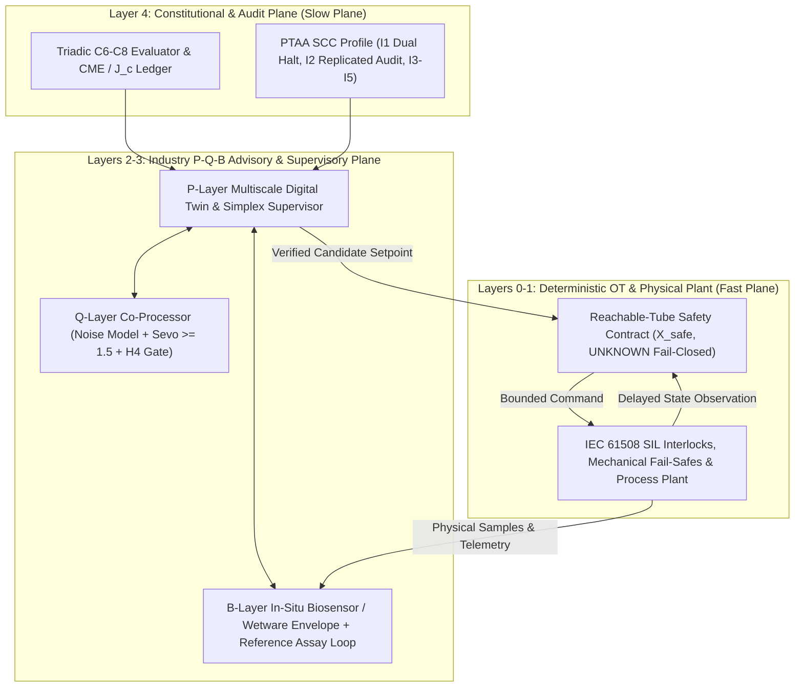

# Industry P–Q–B: A Hybrid Classical–Quantum–Biological Industrial, Economic, and Governance Architecture for Planetary, Civilizational, and Infrastructural Resilience

**Document Identifier:** `SPEACE-PQB-STD-T007-EN` (International Publication Edition `v1.0`)  
**Date:** 2026-11-27  
**Target Audiences:**
1. **International Standards Bodies:** `ISO/IEC JTC 1/SC 42` (Artificial Intelligence), `ISO/IEC JTC 1/SC 7` (Systems and Software Engineering), `IEC TC 65` (Industrial-Process Measurement, Control and Automation), `CEN-CENELEC JTC 21`.
2. **European & Multilateral Policy Institutions:** European Commission, European Parliament, National Ministries of Industry, Economy, Environment, and Civil Protection, OECD, and UN Statistical Commission (`UN SEEA`).
3. **Industrial Systems Architects & Infrastructure Operators:** Water, energy, green chemistry, agrifood, healthcare, circular manufacturing, and resilient civil-engineering sectors.

**Reference Implementations & Normative Specifications:**
- `b_speace` (`Industry P–Q–B` Core & Safeguard): [T002_INDUSTRY_PQB_FRAMEWORK.md](T002_INDUSTRY_PQB_FRAMEWORK.md), [T006_INDUSTRY_PQB_TRIADIC_SAFEGUARD_SPEC.md](T006_INDUSTRY_PQB_TRIADIC_SAFEGUARD_SPEC.md), `b_speace/pqb_safeguard/evaluator.py`
- `q_speace` (Triadic Safeguard, Safe Assimilation & Compliance): `q_speace/docs/T254_TRIADIC_SAFEGUARD_AND_POLYCRISIS_RESILIENCE_SPEC.md`, `q_speace/docs/T217_SAFE_ASSIMILATION_LIFECYCLE_SPEC.md`, `q_speace/docs/T240_REGULATORY_COMPLIANCE_AND_ANNEX_IV_GUIDE_EN.md`
- Economic & Cross-Border Primitives: `q_speace/q_speace/economy/primitives.py`, `q_speace/q_speace/ptaa/scc.py`

---

## Abstract

Contemporary industrial paradigms (Industry 4.0 cyber-physical automation and Industry 5.0 human-centricity) and scalar macroeconomic accounting face two structural failure modes under **systemic polycrises**—the simultaneous, mutually reinforcing interaction of climatic-ecological, economic, social, sanitary, and cyber-infrastructural shocks. First, scalar monetary metrics act as a lossy projection that permits **fictitious compensation**, allowing monetary output to rise while irreversibly depleting ecological regeneration, public health, or infrastructure redundancy. Second, conventional digital control loops remain decoupled from rapid molecular-scale metrology and selective quantum-chemical estimation.

This document specifies **Industry P–Q–B**, a closed-loop engineering and governance architecture integrating **Procedural/Classical (`P`)**, **Quantum (`Q`)**, and **Biological (`B`)** information processing under deterministic **Simplex fail-closed uncertainty governance**, governed by three constitutional safeguarding criteria (`T254` / `T006`):
- **Criterion `C6` (Non-Compensable Triadic Substrate Viability):** an exact $3 \times 4$ partition of a 12-dimensional non-fungible capital vector (`CME`) protecting **Planet Earth**, **Human Civilization**, and **Critical Technologies & Infrastructures** via strict Leontief floors and cross-pillar anti-sacrifice bounds;
- **Criterion `C7` (Coupled Anti-Polycrisis & Anti-Risk-Transfer Shield):** discrete multi-horizon propagation across five interconnected crisis domains blocking interventions that transfer collateral risk or amplify systemic synergy;
- **Criterion `C8` (Voluntary Bioregenerative Civil-Protection Habitats):** engineering and legal standards for terrestrial, hybrid-federated, and future off-Earth closed-loop human habitats based strictly on voluntary individual opt-in and guaranteed free exit, `N+2` Leontief life-support and psychosocial wellbeing reserves, reference-verified `B`-layer potability loops, and a strict prohibition against abandoning or degrading Planet Earth.

> [!IMPORTANT]
> **Epistemic Rigor & Non-Claims (`BCEL` Filter):**  
> This document makes **no claim** of artificial consciousness, biological sentience in cell-free or organoid substrates, superluminal signaling via quantum entanglement, or universal quantum advantage. Every `P`, `Q`, and `B` subsystem is treated strictly as a calibrated, falsifiable metrological or computational instrument subject to physical conservation laws, empirical 4-way ablation against classical baselines, and human institutional authority.

---

## Part I — European & Multilateral Policy Brief

### 1. Executive Summary for Policymakers

European and international industrial policy faces an acute strategic trilemma: accelerating industrial competitiveness and technological sovereignty, achieving net-zero ecological regeneration, and safeguarding social cohesion and public health amidst compounding polycrises. Current ESG disclosures and ex-post environmental assessments suffer from high verification latency, greenwashing vulnerability, and inability to model cross-sector risk transfer.

**Industry P–Q–B** offers an immediately actionable, standards-ready technical foundation that operationalizes existing European and international legal frameworks:

1. **Verifiable Anti-Greenwashing Industrial Metrology (`P + Q + B`):** Pairs low-energy, rapid in-situ cell-free biomolecular sensors (`B`) with periodic accredited laboratory assays (`LC-MS`, `ICP-MS`) and classical multiscale digital twins (`P`), enabling continuous physical verification of water, air, soil, and material circularity while deploying quantum co-processors (`Q`) selectively where proven superior for green catalysis and filtration materials.
2. **Non-Compensable National & Corporate Accounting (`CME` 12D + `J_c`):** Extends the *UN System of Environmental-Economic Accounting (SEEA)* and the *EU Ecodesign for Sustainable Products Regulation (ESPR)* Digital Product Passport with a machine-verifiable thermodynamic 5-tuple (`J_c`) and a 12-axis non-fungible capital balance (`CME`), preventing fiscal or industrial policies from trading away biosphere integrity or human health for short-term nominal gains.
3. **Resilient Civil-Protection Infrastructure (`C8` Voluntary Habitats):** Directs construction, water-reuse, clean-energy, and agritech innovation toward modular, closed-loop bioregenerative habitats (starting with resilient terrestrial districts and public sanctuaries) accessible strictly by free individual choice—either during polycrisis emergencies or for personal wellbeing—without relaxing environmental protection of Planet Earth.

### 2. Direct Alignment with European Union Legislation & International Frameworks

| Regulatory Instrument | Statutory Requirement | Industry P–Q–B Technical Realization (`b_speace` / `q_speace`) |
|---|---|---|
| **EU AI Act** *(Reg. (EU) 2024/1689)* | Art. 9 (Risk Management), Art. 14 (Human Oversight), Art. 15 (Accuracy/Robustness), Art. 17 (`QMS`), Art. 27 (`FRIA`), `Annex IV` Technical Documentation | Deterministic human-in-command gate (`C1`), Simplex fail-closed fallback on `Q`/`B` uncertainty, coupled polycrisis stress-testing (`C7`), and SHA-256 verifiable `Annex IV` / `FRIA` technical packs (`T240`/`T241`). |
| **Cyber Resilience Act (CRA)** *(Reg. (EU) 2024/2847)* | Secure-by-default OT/IT design, vulnerability handling, and Software Bill of Materials (`SBOM`) | Strict OT Layer-0 hardware isolation, epoch-fenced replica failover (`T005`), and automated CycloneDX `SBOM` generation (`T241`). |
| **ESPR & European Green Deal** *(Reg. (EU) 2024/1781)* | Digital Product Passports, circularity, zero-pollution water/soil/air action plans | Per-batch thermodynamic passport `J_c = (J, ΔS, ΔI_c, R_b, ΔC, confidence)` backed by `B + Reference` in-situ biosensing (`T003`/`T006`). |
| **GDPR** *(Reg. (EU) 2016/679)* | Art. 25 Data protection by design and by default | Privacy-by-default SHA-256 hashed telemetry records (`T208` §4.3); zero raw personal data in control or audit loops. |
| **UN SEEA & Beyond-GDP Agenda** | Integration of natural, social, and produced capital into national accounts | Quarterly 12-dimensional non-fungible `CME` satellite accounts coupled to sovereign fiscal/credit guardrails (`C6`). |
| **Cross-Border Autonomous Governance** | Interoperable safety across multi-jurisdictional supply chains and grids | `PTAA` Shared Constitutional Core (`SCC` `I1–I5`, Track A `A1–A4` only), strictly isolating experimental `A5` research in `Annex S` sandboxes. |

### 3. Macroeconomic, Fiscal, and Sovereign Finance Instruments

To make regenerative `Industry P–Q–B` adoption economically self-sustaining for private enterprises and sovereign states without distorting open consumer markets:

1. **Dual National Budgeting (`GDP + 12D CME`):** Finance ministries evaluate annual budgets and industrial subsidies against `PQBTriadicSafeguardController`. Any macro-fiscal package projected to push an axis of `earth_biosphere`, `human_civilization`, or `tech_infrastructure` below $\tau^{\mathrm{axis}}_P$ or exceed `max_single_axis_sacrifice` triggers mandatory programmatic rebalancing.
2. **Thermodynamic Corporate Incentives & Prudential Credit Weighting (`J_c`):**
   $$J_c = \left(J,\; \Delta S,\; \Delta I_c,\; R_b,\; \Delta C,\; \mathrm{confidence}\right)$$
   Accelerated depreciation, R&D tax credits, and European Investment Bank / national development bank credit guarantees are indexed to verified useful exergy $J$, bounded/negative entropy export $\Delta S$, residual regenerative budget $R_b \in [0, 1]$, and empirical measurement completeness (`confidence`).
3. **Destination-Anchored Public Procurement Rails (`DAT`):** While private money and free enterprise remain untouched, sovereign public-investment disbursements (grid hardening, water remediation, pandemic preparedness, `C8` resilient civil habitats) utilize cryptographically scoped `DAT` settlement keys (`bound_to` audited `C6–C8` deliverables), eliminating subsidy diversion and speculative leakage.

---

## Part II — Normative Technical Specification (ISO/IEC Draft Standard Format)

> [!NOTE]
> **Normative Conventions (ISO/IEC Directives, Part 2):**  
> In Part II, the verbal forms **SHALL** and **SHALL NOT** indicate mandatory requirements strictly to be followed in order to conform to this specification; **SHOULD** and **SHOULD NOT** indicate recommended choices; **MAY** indicates a permissible course of action.

### Clause 1 — Scope

This Technical Specification defines:
1. the functional architecture and closed-loop **Simplex uncertainty-governance interfaces** of an **Industry P–Q–B** system integrating classical (`P`), quantum (`Q`), and biological (`B`) computing layers;
2. the **Triadic Substrate Viability (`C6`)** and **Coupled Polycrisis Anti-Risk-Transfer (`C7`)** mathematical constraints over a 12-dimensional non-fungible capital state;
3. the **Voluntary Bioregenerative Protective Habitat (`C8`)** capacity, metrology, and human-autonomy verification protocol;
4. the **4-way empirical ablation** and **staged assimilation (`S0–S7`)** conformity assessment procedures.

This specification applies to advisory decision-support, industrial digital twins, automated supervisory control architectures, and public-infrastructure planning systems. It **SHALL NOT** be construed as authorizing autonomous physical, ecological, wetware, or financial actuation outside qualified `IEC 61508` / `T217` hardware interlocks and human statutory authority.

### Clause 2 — Normative References

- **ISO/IEC 42001:2023**, *Information technology — Artificial intelligence — Management system*
- **ISO/IEC 23894:2023**, *Information technology — Artificial intelligence — Guidance on risk management*
- **ISO/IEC 22989:2022**, *Information technology — Artificial intelligence — Artificial intelligence concepts and terminology*
- **IEC 61508 (All Parts)**, *Functional safety of electrical/electronic/programmable electronic safety-related systems*
- **IEC 62443 (All Parts)**, *Security for industrial automation and control systems*
- **RFC 8259**, *The JavaScript Object Notation (JSON) Data Interchange Format* (strict finite numeric serialization)

### Clause 3 — Terms, Definitions, and Abbreviated Terms

- **3.1 Procedural Layer (`P`):** Deterministic and statistical classical computing stack executing conservation-law models, reachable-tube safety verification, Simplex fallback switching, and constitutional policy enforcement.
- **3.2 Quantum Layer (`Q`):** Quantum processor or noise-modeled quantum simulator executing bounded molecular, electronic-structure, or combinatorial subproblems under an explicit entropic-efficiency gate (`Sevo`).
- **3.3 Biological Layer (`B`):** Calibrated cell-free biomolecular transduction assay (e.g., allosteric transcription-factor Hill biosensors) or safety-interlocked bio-electric/organoid signal-processing interface paired with accredited reference analytical instrumentation.
- **3.4 Capital Multi-Vector Extension (`CME`):** Ordered 12-tuple $c \in [0, 1]^{12}$ of normalized, non-fungible stock indicators partitioned bijectively across `earth_biosphere`, `human_civilization`, and `tech_infrastructure`.
- **3.5 Entropic Efficiency (`Sevo`):** Dimensionless ratio $\mathrm{Sevo} = \Delta U / \Delta S_{\mathrm{info}}$ comparing marginal verified utility gain against informational entropy cost.
- **3.6 Polycrisis Synergy Index ($\Pi$):** Normalized quadratic form measuring simultaneous cross-domain crisis co-activation weighted by the inter-crisis amplification matrix $W$.

### Clause 4 — System Architecture and Closed-Loop Simplex Governance

1. **4.1 Authority Hierarchy:** Layer `P` **SHALL** retain sole supervisory authority to accept, downgrade, or reject outputs from `Q`, `B`, or generative advisory components. Generative model outputs **SHALL** be treated as untrusted proposals incapable of directly mutating plant state (`T208` §3.4).
2. **4.2 Quantum Dispatch Gate (`Q`):** A conforming system **SHALL NOT** dispatch or accept a `Q`-layer result unless:
   - a calibrated hardware/simulator noise model and power cap (`max_power_w`) are configured;
   - $\mathrm{Sevo} \ge \mathrm{Sevo}_{\min}$ (default `1.5`) and quantum estimation uncertainty $u_Q \le u_{Q,\max}$ (default `0.35`);
   - an analytical or empirical classical comparator (`H4` dequantization gate) confirms non-inferiority net of setup and marginal energy costs. Otherwise, `P` **SHALL** fall back deterministically to the classical surrogate.
3. **4.3 Biological Metrology & Wetware Interlocks (`B`):**
   - Where `B` comprises cell-free chemical/biological threshold sensors, the system **SHALL** schedule periodic verification against accredited reference instrumentation (e.g., `LC-MS`, `ICP-MS`, `qPCR`). Whenever absolute normalized disagreement exceeds $\delta_{B,\mathrm{ref}}$ (default `0.15`), `P` **SHALL** downgrade `B` and route control decisions exclusively to reference assays (`BLOCKED_PQB_TELEMETRY_ENVELOPE`).
   - Where `B` comprises bio-electric or organoid wetware interfaces, the adapter **SHALL** enforce a hardware- and software-independent `WetwareSafetyEnvelope` bounding voltage, current, charge density per phase, stimulation frequency, temperature, and pH prior to every stimulation pulse.
4. **4.4 Fast/Slow Plane Separation:** Consensus ledgers (`DLT`), remote `MCP` advisory calls, and `CME` macro-accounting **SHALL** execute strictly on the slow governance plane and **SHALL NOT** be placed in the real-time motor or `IEC 61508` Layer-0 safety loop (`I1` halt SLA preservation).
5. **4.5 Numeric Integrity:** All boundary records **SHALL** reject `NaN`, `±Infinity`, and out-of-domain values fail-closed and serialize strictly under `RFC 8259` (`allow_nan = false`).

### Clause 5 — Normative Mathematical Requirements (`C6`, `C7`, `C8`)

#### 5.1 Triadic Non-Compensability (`C6`)
The 12 `CME` state variables **SHALL** be partitioned into three disjoint 4-axis sets:
- $\mathcal{I}_{\mathrm{Earth}} = \{\text{ecology}, \text{regeneration}, \text{matter}, \text{coherence}\}$
- $\mathcal{I}_{\mathrm{Civ}} = \{\text{wellbeing}, \text{distribution}, \text{time}, \text{innovation}\}$
- $\mathcal{I}_{\mathrm{Infra}} = \{\text{energy}, \text{information}, \text{resilience}, \text{reversibility}\}$

A candidate transition $c^{\mathrm{pre}} \to c^{\mathrm{post}}$ **SHALL** be rejected (`BLOCKED_PILLAR_FLOOR` or `BLOCKED_CROSS_PILLAR_SACRIFICE`) if for any $P \in \{\mathrm{Earth}, \mathrm{Civ}, \mathrm{Infra}\}$:
$$\min_{i \in \mathcal{I}_P} c^{\mathrm{post}}_i < \tau^{\mathrm{axis}}_P \quad \lor \quad \frac{1}{4}\sum_{i \in \mathcal{I}_P} c^{\mathrm{post}}_i < \tau^{\mathrm{mean}}_P \quad \lor \quad \min_{i \in \mathcal{I}_P}\left(c^{\mathrm{post}}_i - c^{\mathrm{pre}}_i\right) < -\delta^{\max}_{\mathrm{sacrifice}}.$$
Positive aggregate gain on $\frac{1}{12}\sum_{j=1}^{12} (c^{\mathrm{post}}_j - c^{\mathrm{pre}}_j)$ **SHALL NOT** override any violated inequality above.

#### 5.2 Coupled Polycrisis Propagation & Anti-Risk-Transfer (`C7`)
Let $s^{(0)} \in [0, 1]^5$ represent normalized severities across $(\text{climatic\_ecological}, \text{economic}, \text{social}, \text{sanitary}, \text{cyber\_infrastructural})$, $W \in [0, 1]^{5 \times 5}$ ($W_{dd} = 0$) the cross-crisis coupling matrix, $\gamma \in (0, 1)^5$ the intrinsic damping vector, and $M \in \mathbb{R}_{\ge 0}^{3 \times 5}$ ($\sum_q M_{Pq} \le 1$) the substrate exposure matrix. Over horizon $H \ge 1$:
$$s^{(t+1)}(u) = \mathrm{clip}\!\Big((1 - \gamma) \odot s^{(t)}(u) + W s^{(t)}(u) + u, \; 0, \; 1\Big), \qquad t = 0, \dots, H-1.$$
A proposal with forcing $u \in [-1, 1]^5$ **SHALL** be rejected if:
1. **Cross-Domain Risk Transfer (`BLOCKED_RISK_TRANSFER`):** $\max_{1 \le t \le H}\left(s^{(t)}_q(u) - s^{(t)}_q(0)\right) > \delta_{\mathrm{collateral}}$ for any crisis domain $q \in \{1..5\}$;
2. **Systemic Amplification (`BLOCKED_POLYCRISIS_AMPLIFICATION`):** peak crisis severity breaches $\tau_{\mathrm{ceil}}$ (or worsens an already above-ceiling baseline), final synergy $\Pi(s^{(H)}(u)) > \Pi(s^{(H)}(0)) + 0.01$, or post-cascade projected stock $\min_{i \in \mathcal{I}_P} c^{\mathrm{post}}_i - \sigma_{\mathrm{casc}}\big(0.5\,[M s^{(H)}(u)]_P + \max(0, [M s^{(H)}(u) - M s^{(H)}(0)]_P)\big) < \tau^{\mathrm{axis}}_P$.

#### 5.3 Voluntary Bioregenerative Protective Habitat Protocol (`C8`)
Any system evaluating, certifying, or supervising an artificial human-protection habitat (`terrestrial`, `hybrid_federated`, or `extraterrestrial`) **SHALL** enforce all of the following:
1. **Autonomy & Non-Coercion (`BLOCKED_REFUGE_COERCION`):** `voluntary_opt_in_only == true`, `free_exit_guaranteed == true`, `coercive_relocation_forbidden == true`, `universal_non_discriminatory_access == true`, and verified individual consent across all transfer requests, granting equal admission rights to `polycrisis_protection` and `personal_wellbeing` motivations.
2. **Leontief `N+2` Life-Support & Wellbeing Capacity (`BLOCKED_REFUGE_RESOURCE_DEFICIT`):** With redundancy factor $\kappa \ge 1.25$:
   $$N_{\mathrm{cert}} = \left\lfloor \min\left(\frac{S_{\mathrm{water}}}{15.0\kappa},\; \frac{S_{\mathrm{food}}}{2200.0\kappa},\; \frac{S_{\mathrm{O_2}}}{0.84\kappa},\; \frac{S_{\mathrm{power}}}{P_{\min}(\text{mode})\kappa}\right) \right\rfloor \ge N_{\mathrm{req}},$$
   where $P_{\min}(\text{mode})$ is `1.5 kW/person` (`terrestrial`), `2.5 kW/person` (`hybrid_federated`), or `3.5 kW/person` (`extraterrestrial`), alongside minimum thresholds on medical-sanitary care ($I_{\mathrm{med}} \ge 0.75$), psychosocial living wellbeing ($I_{\mathrm{well}} \ge 0.70$), autonomy reserve days (`90` / `180` / `365` days), closed-loop recycling efficiency (`0.85` / `0.92` / `0.98`), radiation/environmental shielding (`0.70` / `0.85` / `0.95`), and `biosensor_reference_verified == true`.
3. **Honest Coverage Reporting & Non-Abandonment:** The system **SHALL** report `civilization_coverage_ratio = min(1.0, N_cert / N_target)` and **SHALL NOT** set `universal_humanity_coverage_ready = true` unless $N_{\mathrm{cert}} \ge N_{\mathrm{target}}$. Every habitat plan **SHALL** simultaneously pass Clauses 5.1 and 5.2 so Earth's biosphere and external civilization are never degraded to construct or supply the habitat.

### Clause 6 — Empirical Ablation and Staged Qualification (`S0–S7`)

1. **6.1 Mandatory 4-Way Industrial Ablation:** Prior to operational claims, an `Industry P–Q–B` workflow **SHALL** be benchmarked across `P-only`, `P+B`, `P+Q`, and `P+Q+B` on identical held-out scenarios, reporting separate fixed setup/calibration CAPEX and marginal per-trial OPEX/joules to establish a finite break-even horizon.
2. **6.2 Staged Host Assimilation (`T217`):** No component affecting physical plants, ecosystems, or economic allocation **SHALL** be promoted to limited production (`S7`) without sequential, hash-pinned `PASS` dossiers across `S0` (Preregistration & BCEL), `S1` (Mathematical/Code Verification), `S2` (Validated Multidomain Simulation), `S3` (Isolated Host Replica), `S4` (Confined Hardware-in-the-Loop Prototype), `S5` (Independent Multi-Stakeholder Audit — zero self-approval), and `S6` (Passive Shadow Observation).

### Clause 7 — Conformance Profiles

An implementation claims conformance to one of three strictly ordered profiles:
- **Level 1 — `PQB-Advisory-Core` (`L1_PQB_ADVISORY_CORE`):** Full software conformance to Clauses 4.1, 4.5, 5.1 (`C6`), and 5.2 (`C7`) in offline digital twins and macroeconomic/industrial planning (`advisory_only = true`).
- **Level 2 — `PQB-Simplex-Plant` (`L2_PQB_SIMPLEX_PLANT`):** Level 1 plus Clauses 4.2–4.4 and 6.1–6.2 (`B + Reference` metrology loop, `Q` `Sevo`/`H4` gate, and `IEC 61508` Layer-0 isolation).
- **Level 3 — `PQB-Civil-Resilience-C8` (`L3_PQB_CIVIL_RESILIENCE_C8`):** Level 2 plus Clause 5.3 (`C8` voluntary bioregenerative habitat verification, `N+2` Leontief reserves, and statutory non-abandonment coupling).

### Normative Annex A — Machine-Readable JSON Schema Specifications (`Draft 2020-12`)

Conforming implementations **SHALL** validate boundary records and conformance bundles against the three closed (`additionalProperties: false`), `RFC 8259`-strict JSON Schema (`https://json-schema.org/draft/2020-12/schema`) files shipped in `b_speace/pqb_safeguard/schemas/`:

| Annex ID | Schema File | `$id` URI | Scope & CLI Verification |
|---|---|---|---|
| **Annex A.1** | `b_speace/pqb_safeguard/schemas/pqb_campaign_proposal.schema.json` | `https://rigeneproject.org/schemas/speace-pqb/v1/pqb_campaign_proposal.schema.json` | Validates `PQBCampaignProposal`, 12D `PQBCapitalVector` (`CME`), 5D `PolycrisisState`, `PQBTelemetrySnapshot`, and `VoluntaryBioregenerativeHabitatPlan` (`C8`). |
| **Annex A.2** | `b_speace/pqb_safeguard/schemas/pqb_safeguard_verdict.schema.json` | `https://rigeneproject.org/schemas/speace-pqb/v1/pqb_safeguard_verdict.schema.json` | Validates SHA-256 sealed `PQBSafeguardVerdict` advisory outputs (`advisory_only: true`). |
| **Annex A.3** | `b_speace/pqb_safeguard/schemas/pqb_conformance_manifest.schema.json` | `https://rigeneproject.org/schemas/speace-pqb/v1/pqb_conformance_manifest.schema.json` | Validates Clause 7 Conformance Declarations (`L1`–`L3`), pinning canonical SHA-256 digests of Annexes A.1–A.3, `profile_sha256`, and `benchmark_report_sha256` (`bspace safeguard conformance --level L3`). |

---

## Part III — Sectoral Industrial Deployment Matrix & 10-Year Global Rollout

### 1. Industrial Transition Matrix across Six Strategic Sectors

| Sector | `P` Layer (Classical Multiscale & Safety) | `Q` Layer (Selective Subproblem, $\mathrm{Sevo} \ge 1.5$) | `B` Layer (`Cell-Free` + Reference Lab) | Primary `CME` & Polycrisis Impact |
|---|---|---|---|---|
| **Water & Green Chemistry** | Adsorption/breakthrough digital twin (`T003`), automatic valve cut-off | Selective ligand binding for PFAS & heavy metals | Continuous inline cell-free effluent threshold sensors + `ICP-MS` | Raises `ecology`, `regeneration`; mitigates `climatic_ecological` & `sanitary` |
| **Clean Energy & Smart Grids** | Delay-aware reachable-tube `SafetyContract` (`T218`) & diffusive load sharing | Post-lithium solid-state electrolyte & catalyst screening | Bio-electrochemical/microbial fuel-cell & transformer-oil fault sensing | Raises `energy`, `resilience`, `reversibility`; blocks grid blackout cascades |
| **Regenerative Agrifood** | Soil mass-balance & irrigation controller enforcing $R_b \ge R_{b,\min}$ | Low-temperature nitrogen-fixation catalyst modeling | Field-deployable mycotoxin, nitrate & soil-pathogen assays | Raises `matter`, `wellbeing`, `regeneration`; mitigates `social` & `economic` food shocks |
| **Public Health & Pharma** | Privacy-safe SHA-256 federated outbreak modeling | Target-pocket docking benchmarked vs classical ML potentials | Decentralized wastewater & point-of-need pathogen biosensors | Raises `wellbeing`; early containment of `sanitary` polycrisis cascades |
| **Circular Manufacturing & ICT** | CycloneDX `SBOM`, `J_c` thermodynamic product passport & `T005` failover | Selective rare-earth separation chelation chemistry | Bio-leaching & industrial wastewater toxicity monitoring | Raises `matter`, `information`, `reversibility`; CRA & ESPR compliance |
| **Bioregenerative Civil Habitats (`C8`)** | Leontief `N+2` ECLSS controller & cryptographic `C8` consent/exit registry | Closed-loop $\text{CO}_2$ reduction & catalytic air revitalization | Continuous potable water/air loop biosensing verified by `LC-MS` | Protects `human_civilization` (`polycrisis_protection` & `personal_wellbeing`) with zero Earth harm |

### 2. Phased Ten-Year International Implementation Roadmap

| Horizon | `T217` Gates | Industrial & Standards Milestones | Sovereign Economic & Policy Milestones |
|---|---|---|---|
| **Phase I (Years 1–2)** | `S0–S2` | Standardize JSON schemas (`CME`, `J_c`, `C6–C8`) within `ISO/IEC` working groups; deploy open-source `PQBTriadicSafeguardController` in corporate digital twins; run 4-way sector ablations. | Launch experimental quarterly `12D CME` national satellite accounts (`UN SEEA` extension); integrate `T240` `Annex IV` packs into EU AI Act regulatory sandboxes. |
| **Phase II (Years 2–4)** | `S3–S5` | Commission confined Hardware-in-the-Loop (`HIL`) industrial pilots in water treatment, microgrids, and agrifood; build first terrestrial closed-loop `N+2` civil habitat demonstrators. | Establish bilateral/multilateral `PTAA Track A` (`I1–I5`) industrial corridors; pilot `J_c`-indexed green procurement and `DAT`-anchored municipal resilience funds. |
| **Phase III (Years 4–7)** | `S6–S7` | Scale certified Level 2 (`PQB-Simplex-Plant`) controllers across critical infrastructures; commission regional voluntary terrestrial `C8` sanctuaries integrated into public civil-protection networks. | Bind national budget laws and development-bank capital weights to non-compensable `C6` floors and `C7` polycrisis stress tests. |
| **Phase IV (Years 7–10+)** | Iterative `S0–S7` | Full circular industrial interoperability; progressive `T217` aerospace/life-support qualification of hybrid terrestrial and orbital/off-Earth `C8` modules where mass-energy balances are proven. | Multilateral `PTAA` polycrisis coordination treaty and International `C8` Voluntary Habitat Charter guaranteeing universal non-discriminatory access, free exit, and planetary non-abandonment. |
